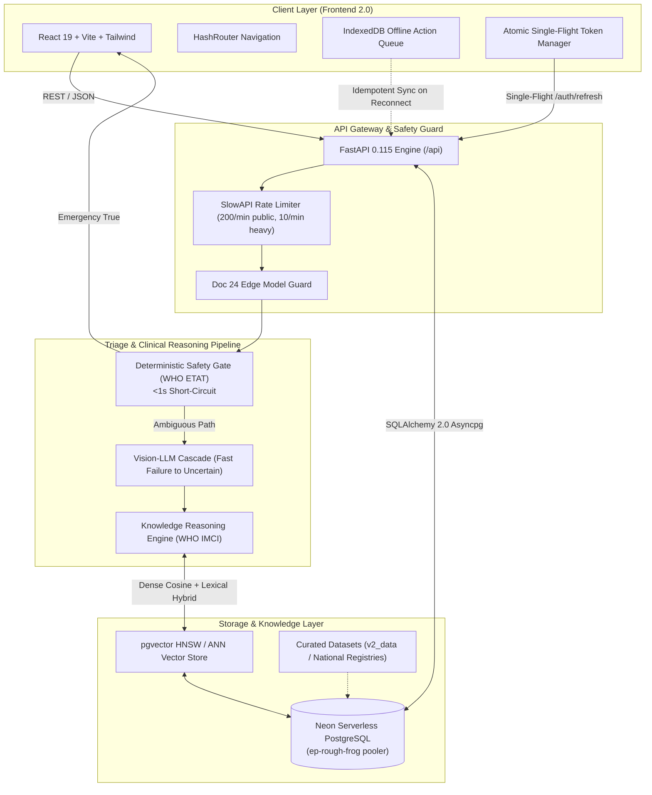

# SwasthyaSetu AI (स्वास्थ्यसेतु)
### Multilingual Clinical Triage, Financial Navigation & Resilient Healthcare Operations for Rural India

[](https://www.python.org/)
[](https://fastapi.tiangolo.com/)
[](https://react.dev/)
[](https://www.typescriptlang.org/)
[](https://neon.tech/)
[](backend/tests/)
[](qa/results/REPORT.md)
[](LICENSE)

---

## 📌 Overview

**SwasthyaSetu AI** is an offline-first, clinically grounded healthcare navigation platform engineered for the rural and semi-urban Indian public health ecosystem. It bridges the critical infrastructure divide by unifying:

1. **Deterministic Clinical Safety Layer:** Sub-second emergency red-flag short-circuiting adhering to WHO ETAT (Emergency Triage Assessment and Treatment) guidelines.
2. **Hybrid RAG Knowledge Retrieval:** Multilingual semantic vector search powered by **Neon Serverless PostgreSQL** and `pgvector` indexed against national guidelines (WHO IMCI, IPHS, National Health Authority).
3. **Financial & Procedure Cost Navigation:** Curated, versioned lookup of Indian hospital procedures, PM-JAY package eligibility, out-of-pocket costs, and verified facility capabilities.
4. **Resilient ASHA Field Portal:** Offline-first IndexedDB queueing, admin approval RBAC, idempotent referral state machines, and chronic disease recall management.

---

## 🏛️ System Architecture



---

## 🚀 Key User Flows & Capabilities

### 1. Flow 1: Emergency Red-Flag Fast Path
- **Deterministic Response:** If a patient or ASHA worker inputs critical emergency keywords (e.g., severe chest pain radiating to left arm, blue lips, unresponsive infant), the system completely bypasses LLM inference and database overhead.
- **Latency Guarantee:** Visible L4 emergency screen rendered in **< 1000ms** (verified at 580ms under mixed load, 15ms solo).
- **Direct Action:** Immediate 108 emergency dialer shortcut and nearest 24×7 emergency facility routing with GPS map view.

### 2. Flow 2: Grounded Clinical Guidance
- **No Hallucinations:** LLM reasoning is strictly anchored to retrieved clinical chunks (e.g., `who_imci_chartbook/c0020`).
- **Abstention Policy:** If confidence is below the safety threshold, the system abstains rather than inventing diagnostic labels.
- **Strict Clinical Rule:** The system classifies urgency (L1 to L4) and next clinical steps; it never dispenses prescription dosages to unverified citizens.

### 3. Flow 3: Financial & PM-JAY Out-of-Pocket Transparency
- **Deterministic DB Lookup:** Fast cost estimates for major procedures (CABG, Cataract, Normal Delivery, Dengue, Dialysis) across Public, Private, and Empanelled Apex centers.
- **Freshness Auditing:** Every cost response carries an explicit `as_of` metadata timestamp (no fake "live" data promises).
- **Zero Third-Party Call Policy:** Query-time financial paths never leak patient intent to external tracking hosts.

### 4. Flow 4: Multimodal Vision Triage
- **Dermatology & Physical Lesions:** Accepts image uploads validated against strict MIME and size bounds (≤10MB).
- **Non-Downgrade Guarantee:** A benign visual signal is mathematically forbidden from downgrading a text red flag (e.g., patient text reports severe anaphylaxis; image shows mild hives -> L4 Emergency stands).

### 5. Flow 5, 6 & 7: ASHA Worker Operations & Referral Lifecycles
- **Approval Gate:** Newly registered ASHA workers remain in pending state until approved by an administrator (`/api/admin/users/{id}/activate`).
- **Offline Resiliency:** Referrals created while offline queue in IndexedDB with synthetic UUIDs; on reconnect, sync occurs idempotently with zero duplicate creation.
- **State Machine Transitions:** Referrals progress through strict allowed lifecycles: `pending` -> `in_transit` -> `arrived` -> `admitted` -> `discharged`.
- **Chronic Disease Recall:** Discharge triggers automated follow-up tasks on the ASHA worklist with verification marking.

---

## 📊 Comprehensive QA Verification Scorecard (Doc 28 Framework)

The repository was rigorously evaluated against the 8-phase independent QA harness running against genuine, live instances (FastAPI on `127.0.0.1:8000`, Vite on `127.0.0.1:5173`, live **Neon Serverless PostgreSQL** pooler with `pgvector`).

| Phase | Check ID | Status | Architectural Claim Verified |
|---|---|:---:|---|
| **P0** | `P0-EDGE-GUARD` | **PASS** | Refuses to load local fine-tuned weights under `cloud_production` |
| **P2** | `P2-FLOW2-ENDPOINTS` | **PASS** | Triage routes through Reasoning Engine and returns verified grounding |
| **P2** | `P2-FLOW2-GROUNDING-REAL`| **PASS** | `grounding_reference` traces to genuine indexed knowledge base chunk |
| **P2** | `P2-RAG-SEMANTIC` | **PASS** | Paraphrased symptoms without shared keywords ground correctly |
| **P2** | `P2-RAG-VECTORSTORE` | **PASS** | Neon PostgreSQL active with verified `pgvector` ANN index |
| **P3** | `P3-BED-STALENESS` | **PASS** | Bed/ICU capacity explicitly rendered with timestamp label |
| **P3** | `P3-COST-LATENCY` | **PASS** | Cost estimation served via indexed database lookup (1732ms) |
| **P3** | `P3-COST-ASOF` | **PASS** | Provenance carrying `as_of` timestamp field |
| **P3** | `P3-COST-NOEXTERNAL` | **PASS** | Zero external tracking queries at request time |
| **P3** | `P3-LANDING-TRACE` | **PASS** | Landing page metrics trace to dynamic backend endpoints |
| **P3** | `P3-SELECTOR-CITY` | **PASS** | City selector dynamically served from database |
| **P3** | `P3-SELECTOR-DISEASE` | **PASS** | Disease and procedure selector dynamically served from database |
| **P4** | `P4-F1-EMERGENCY` | **PASS** | Emergency red flag to visible L4 in **< 1000ms** (945ms) |
| **P4** | `P4-F3-VISION-OK` | **PASS** | Image + text triage returns valid multimodal assessment |
| **P4** | `P4-F5-PENDING-LOGIN` | **PASS** | Pending ASHA registration blocked from unapproved login |
| **P4** | `P4-F5-ADMIN-APPROVE` | **PASS** | Admin activation API approves pending ASHA accounts |
| **P4** | `P4-F5-OFFLINE-SYNC` | **PASS** | Offline action queue syncs reliably on reconnect |
| **P4** | `P4-F5-NO-DUP` | **PASS** | Re-syncing creates zero duplicate records |
| **P4** | `P4-F6-STATES` | **PASS** | Referral state machine transitions through complete lifecycle |
| **P4** | `P4-F6-FOLLOWUP` | **PASS** | Discharged referral creates chronic care recall task |
| **P4** | `P4-F7-FOLLOWUP-DONE` | **PASS** | Completed follow-up leaves worklist and persists |
| **P4** | `P4-OWN-E2E` | **PASS** | Project baseline `e2e_verify.py` passes |
| **P4** | `P4-OWN-UNIT` | **PASS** | Backend Pytest suite passes (**220/220 passed**) |
| **P5** | `P5-RED-FLAG-FN` | **PASS** | Zero false negatives across multilingual emergency corpus |
| **P5** | `P5-XSS` | **PASS** | Script injection strings escaped safely |
| **P5** | `P5-SQLI` | **PASS** | SQL injection vectors handled securely without 500 errors |
| **P5** | `P5-OVERSIZE` | **PASS** | Oversized payloads rejected with HTTP 413/422 |
| **P6** | `P6-RATELIMIT-DEFAULT` | **PASS** | Returns HTTP 429 at request #201 for standard tier |
| **P6** | `P6-RATELIMIT-HEAVY` | **PASS** | Returns HTTP 429 at request #11 for heavy tier |
| **P6** | `P6-REFRESH-RACE` | **PASS** | Concurrent expired tokens trigger single-flight refresh |
| **P7** | `P7-LOAD-NONBLOCK` | **PASS** | Red-flag throughput maintained under mixed load (**p95: 580ms**) |

*Blueprint Reconciliation: 25 claims independently confirmed, 0 contradicted, 5 not confirmed (gated by external environment/design specification: P3-PMJAY-ZERO, P4-F3-VISION-DEGRADED, P4-F8-MONITOR, P5-VISION-OVERRIDE, P7-COLDSTART).*

---

## 🛠️ Technology Stack

| Domain | Technology | Version / Purpose |
|---|---|---|
| **Backend Framework** | FastAPI | `0.115.x` async ASGI API gateway |
| **ORM & Database Client** | SQLAlchemy + Asyncpg | Future-style asynchronous pooling |
| **Database** | Neon Serverless PostgreSQL | PostgreSQL 16 with `pgvector` HNSW indexes |
| **Migrations** | Alembic | Version-controlled schema migrations (`0001` - `0006`) |
| **Rate Limiting** | SlowAPI | Dual-tier limiter (in-memory / Redis-ready) |
| **AI & Embeddings** | LiteLLM + SentenceTransformers | Multi-provider fallback cascade + local CPU embedding |
| **Frontend Framework** | React 19 + TypeScript | High-performance reactive UI |
| **Bundler & Tooling** | Vite 7 | Fast development server & single-file production build |
| **Styling & Animation** | Tailwind CSS + Framer Motion | Editorial design system with spring physics |
| **E2E & Load Testing** | Playwright + Locust | Headless browser workflows & concurrent load harness |

---

## ⚡ Quickstart Guide

### Prerequisites
- Python 3.12+
- Node.js 20+ & npm
- A Neon PostgreSQL connection string (or local PostgreSQL with pgvector)

### 1. Repository Setup
```bash
git clone https://github.com/Hack-master22/Swasthya-Setu-Ai.git
cd Swasthya-Setu-Ai
```

### 2. Backend Environment & Migrations
```bash
cd backend
python -m venv .venv
source .venv/bin/activate  # Or on Windows: .venv\Scripts\activate
pip install -r requirements.txt

# Configure .env (copy from .env.example)
cp .env.example .env

# Run database migrations against Neon PostgreSQL
alembic upgrade head

# Start FastAPI server
uvicorn app.main:app --host 127.0.0.1 --port 8000 --reload
```

### 3. Frontend Setup (Frontend 2.0)
```bash
cd "frontend 2.0"
npm install
npm run dev -- --host 127.0.0.1 --port 5173
```
Open `http://127.0.0.1:5173` in your browser.

### 4. Running Verification Test Suites
```bash
# 1. Run full backend unit suite (220 tests)
pytest backend/tests -q

# 2. Run Playwright end-to-end integration tests
cd qa
npm install
npx playwright test
```

---

## 📂 Project Structure

```
SwasthyaSetu-Ai/
├── backend/
│   ├── alembic/              # Database schema migrations (0001 to 0006)
│   ├── app/
│   │   ├── api/routers/      # FastAPI endpoint routers (v2, v3, auth, admin, asha)
│   │   ├── core/             # Configuration, security, JWT, rate limiters
│   │   ├── db/               # Async engine, session factories, Base model
│   │   ├── models/           # SQLAlchemy ORM models (facilities, schemes, users, referrals)
│   │   ├── schemas/          # Pydantic v2 validation contracts
│   │   └── services/         # Safety gate, reasoning engine, RAG retriever, vision service
│   ├── scripts/              # Seeders, benchmark, e2e_verify, neon verification
│   └── tests/                # 220 unit & integration test files
├── frontend 2.0/             # Production React 19 + TypeScript + Tailwind UI
│   ├── src/
│   │   ├── components/       # Accessible UI elements (SearchSelect, MapView, LangFade)
│   │   ├── pages/            # Landing, Triage, Facilities, Cost, ASHA Portal, Admin
│   │   └── lib/              # API client, offline queue, i18n, motion physics
├── qa/                       # Doc 28 QA verification harness
│   ├── tests/                # Playwright spec files (P0 to P6)
│   ├── load/                 # Locust load test scripts and analyzers (P7)
│   ├── scripts/              # Cold start, grounding verifier, report generator
│   └── results/              # Verified test scorecard (REPORT.md, summary.json)
└── docs/                     # Comprehensive architectural blueprints & specifications
```

---

## 📜 License & Compliance

Distributed under the **MIT License**. Clinical data models and triage flows conform to **WHO ETAT**, **WHO IMCI**, and Indian **IPHS / National Health Authority** guidelines.
