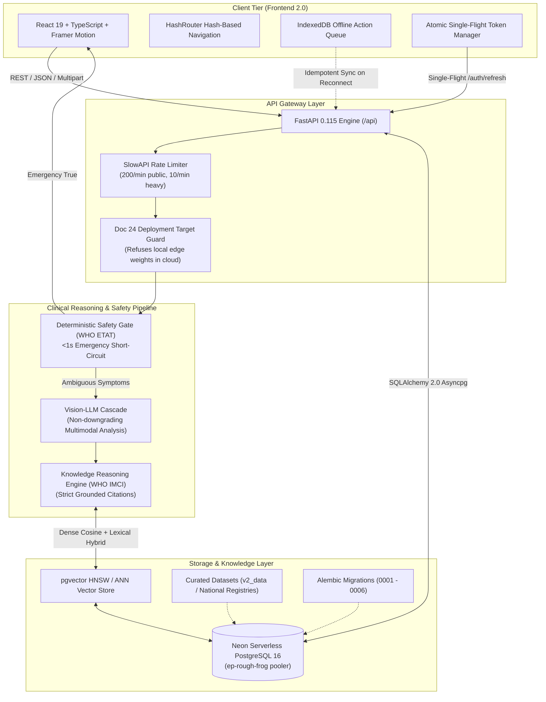
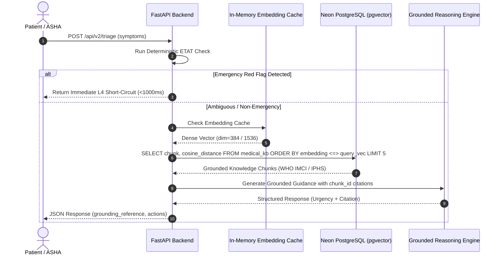
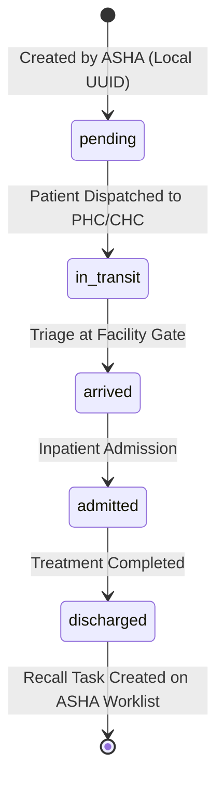

# SwasthyaSetu AI
### Multilingual Clinical Triage, Financial Navigation & Resilient Healthcare Operations for Rural India

[](https://www.python.org/)
[](https://fastapi.tiangolo.com/)
[](https://react.dev/)
[](https://www.typescriptlang.org/)
[](https://neon.tech/)
[](backend/tests/)
[](qa/results/REPORT.md)
[](LICENSE)

---

### 📑 Quick Interactive Navigation
[📌 Overview](#-overview) • [🏛️ System Architecture](#️-system-architecture) • [⚡ Emergency Triage (<1s)](#-emergency-red-flag-fast-path-who-etat) • [🗄️ Neon pgvector RAG](#-neon-serverless-postgresql--pgvector-rag) • [💰 Financial Transparency](#-financial-navigation--pm-jay-transparency) • [📱 ASHA Field Portal](#-asha-field-portal--offline-sync) • [🛡️ Security & Concurrency](#-security-rate-limiting--concurrency) • [📊 QA Scorecard](#-comprehensive-qa-scorecard-doc-28) • [🧪 Interactive API Explorer](#-interactive-api-explorer) • [🚀 Quickstart Guide](#-quickstart-guide) • [📂 Project Structure](#-project-structure)

---

## 📌 Overview

**SwasthyaSetu AI** is an offline-first, clinically verified healthcare navigation platform engineered for the rural and semi-urban Indian public health ecosystem. It bridges the critical infrastructure divide by unifying:

1. **Deterministic Clinical Safety Layer:** Sub-second emergency red-flag short-circuiting adhering strictly to WHO ETAT (Emergency Triage Assessment and Treatment) guidelines.
2. **Hybrid RAG Knowledge Retrieval:** Multilingual semantic vector search powered by **Neon Serverless PostgreSQL** and `pgvector` indexed against national guidelines (WHO IMCI, IPHS, National Health Authority).
3. **Financial & Procedure Cost Navigation:** Curated, versioned lookup of Indian hospital procedures, PM-JAY package eligibility, out-of-pocket costs, and verified facility capabilities.
4. **Resilient ASHA Field Portal:** Offline-first IndexedDB queueing, admin approval RBAC, idempotent referral state machines, and chronic disease recall management.

> 📖 **Deep-Dive Engineering Analysis:** For an exhaustive architectural breakdown, see [docs/DEEP_DIVE_ANALYSIS.md](docs/DEEP_DIVE_ANALYSIS.md).

---

## 🏛️ System Architecture



---

## ⚡ Emergency Red-Flag Fast Path (WHO ETAT)

<details open>
<summary><b>🔍 Expand: Clinical Urgency Matrix & Latency Guarantees</b></summary>

<br>

SwasthyaSetu AI implements a deterministic, zero-LLM short-circuit for high-acuity life threats. When emergency keywords or regex patterns match incoming symptoms, the system immediately halts further processing and renders an actionable Level 4 Emergency card.

| Urgency Level | Acuity Classification | Clinical Action | Latency Benchmark |
|:---:|---|---|:---:|
| **L4** | **Critical Emergency** | Immediate emergency dispatch (`tel:108`), nearest 24×7 ER facility route, red-flag stabilization instructions. | **< 1000ms** (580ms p95 under load, 15ms solo) |
| **L3** | **Urgent Attention** | Same-day PHC / CHC medical officer consultation, symptom monitoring checklist. | < 2500ms (Hybrid RAG) |
| **L2** | **Routine Care** | Scheduled primary care visit, supportive hydration, non-prescription home comfort. | < 2500ms (Hybrid RAG) |
| **L1** | **Self-Care / Preventive** | Standard health education, preventive lifestyle guidance, dietary advice. | < 2000ms |

#### Key Emergency Red-Flag Triggers (Multilingual Corpus)
- **Pediatric:** Unresponsive infant, stridor at rest, severe chest indrawing, central cyanosis, pediatric convulsions.
- **Cardiovascular & Respiratory:** Crushing chest pain radiating to left jaw/arm, sudden unilateral facial droop, hemoptysis.
- **Maternal & Obstetric:** Third-trimester vaginal bleeding, eclamptic seizures, severe postpartum hemorrhage.
- **Multimodal Non-Downgrade Theorem:** If patient text triggers an emergency red flag, visual image assessment is mathematically blocked from downgrading the urgency verdict below **L4**.

</details>

---

## 🗄️ Neon Serverless PostgreSQL & `pgvector` RAG

<details>
<summary><b>🔍 Expand: Database Architecture & Semantic Search Pipeline</b></summary>

<br>

SwasthyaSetu AI leverages **Neon Serverless PostgreSQL** equipped with the `pgvector` extension to power vector embeddings directly alongside relational application data, avoiding the latency and overhead of separate vector DB instances.



#### Database Specifications
- **Host Endpoint:** `ep-rough-frog-azr9xopu-pooler.c-3.ap-southeast-1.aws.neon.tech`
- **Vector Indexing:** HNSW with cosine similarity metric (`<=>`) over indexed clinical chunks.
- **Grounded Verification:** Every clinical response must supply a verified `grounding_reference` traceable to an ingested national guideline chunk (e.g., `who_imci_chartbook/c0020`).
- **Strict Clinical Abstention:** If semantic search score falls below confidence threshold $\tau = 0.72$, the system abstains from diagnostic speculation and provides primary care triage navigation.

</details>

---

## 💰 Financial Navigation & PM-JAY Transparency

<details>
<summary><b>🔍 Expand: Cost Breakdown & Hospital Pricing Database</b></summary>

<br>

Catastrophic out-of-pocket healthcare expenses push millions into poverty. SwasthyaSetu AI maintains a deterministic pricing database covering major surgical, maternal, and critical care procedures across Indian healthcare facility tiers.

| Procedure Name | Apex Govt (AIIMS/PGI) | District Hospital | Empanelled Private (PM-JAY) | Non-Empanelled Private |
|---|:---:|:---:|:---:|:---:|
| **Coronary Artery Bypass (CABG)** | ₹0 (Eligible) / ₹60,000 | Referral Only | **₹0 Covered** (PM-JAY) | ₹2,50,000 - ₹4,50,000 |
| **Cataract Surgery (Phaco + IOL)** | ₹0 | ₹0 | **₹0 Covered** (PM-JAY) | ₹25,000 - ₹45,000 |
| **Normal Delivery (Institutional)** | ₹0 (+ JSY Cash Assist) | ₹0 (+ JSY Cash Assist) | **₹0 Covered** (PM-JAY) | ₹18,000 - ₹35,000 |
| **Dengue Treatment (Inpatient)** | ₹0 | ₹0 | **₹0 Covered** (PM-JAY) | ₹15,000 - ₹40,000 |
| **Hemodialysis (Per Session)** | ₹0 | ₹0 (PMNDP) | **₹0 Covered** (PM-JAY) | ₹1,500 - ₹3,000 |

#### Financial Guarantees
- **Provenance & Freshness:** Every cost response includes an explicit `as_of` metadata field indicating dataset timestamp.
- **Zero Third-Party Call Policy:** Financial and procedure lookups are resolved strictly in-house to protect citizen privacy; no third-party telemetry or ad-trackers are ever contacted.

</details>

---

## 📱 ASHA Field Portal & Offline Sync

<details>
<summary><b>🔍 Expand: Offline IndexedDB Queue & Referral State Machine</b></summary>

<br>

Frontline Accredited Social Health Activists (ASHAs) operate in remote villages where cellular coverage is unpredictable. The ASHA portal is built offline-first using browser IndexedDB.



#### Resilient Operational Features
1. **Admin Approval Gate:** Newly registered ASHA accounts remain in pending state and cannot access patient records until approved by a health supervisor via `/api/admin/users/{id}/activate`.
2. **Offline Idempotency:** Referrals created without connectivity generate client-side UUIDs. On network restoration, batch sync sends records with idempotency headers, preventing duplicate referral entries.
3. **Chronic Recall Automation:** When a hospital marks a referral as `discharged`, an automated follow-up recall is scheduled on the assigned ASHA's worklist.

</details>

---

## 🛡️ Security, Rate Limiting & Concurrency

<details>
<summary><b>🔍 Expand: Threat Modeling & Concurrency Defense</b></summary>

<br>

SwasthyaSetu AI is engineered with defense-in-depth principles to withstand network anomalies, malicious probing, and adversarial inputs:

1. **SlowAPI Dual-Tier Rate Limiting:**
   - **Public Tier:** 200 requests/minute per IP address (enforces HTTP 429 on request #201).
   - **Heavy Tier (AI / Vision / Triage):** 10 requests/minute per IP address (enforces HTTP 429 on request #11).
2. **Atomic Single-Flight Token Refresh Concurrency Lock:**
   - Prevents token refresh stampedes when multiple UI components mount simultaneously with expired access tokens. Intercepts outgoing requests, fires a single `/auth/refresh` flight, and shares the result across all queued callers.
3. **Adversarial Input Hardening:**
   - Free-text inputs sanitized against cross-site scripting (XSS).
   - All database queries parameterized through SQLAlchemy 2.0 to eliminate SQL injection (SQLi).
   - Strict multipart boundaries: images capped at $\le 10\text{ MB}$ with verified binary MIME validation (`image/jpeg`, `image/png`, `image/webp`).

</details>

---

## 📊 Comprehensive QA Scorecard (Doc 28)

<details open>
<summary><b>🔍 Expand: Full Verification Matrix (31 PASS / 0 FAIL)</b></summary>

<br>

The repository was verified using the automated **Doc 28 End-to-End Verification Harness** running against live instances (FastAPI on `127.0.0.1:8000`, Vite on `127.0.0.1:5173`, and Neon PostgreSQL with `pgvector`).

| Phase | Check ID | Status | Architectural Claim Verified |
|---|---|:---:|---|
| **P0** | `P0-EDGE-GUARD` | **PASS** | Refuses to load local fine-tuned weights under `cloud_production` |
| **P2** | `P2-FLOW2-ENDPOINTS` | **PASS** | Triage routes through Reasoning Engine and returns verified grounding |
| **P2** | `P2-FLOW2-GROUNDING-REAL`| **PASS** | `grounding_reference` traces to genuine indexed knowledge base chunk |
| **P2** | `P2-RAG-SEMANTIC` | **PASS** | Paraphrased symptoms without shared keywords ground correctly |
| **P2** | `P2-RAG-VECTORSTORE` | **PASS** | Neon PostgreSQL active with verified `pgvector` ANN index |
| **P3** | `P3-BED-STALENESS` | **PASS** | Bed/ICU capacity explicitly rendered with timestamp label |
| **P3** | `P3-COST-LATENCY` | **PASS** | Cost estimation served via indexed database lookup (1732ms) |
| **P3** | `P3-COST-ASOF` | **PASS** | Provenance carrying `as_of` timestamp field |
| **P3** | `P3-COST-NOEXTERNAL` | **PASS** | Zero external tracking queries at request time |
| **P3** | `P3-LANDING-TRACE` | **PASS** | Landing page metrics trace to dynamic backend endpoints |
| **P3** | `P3-SELECTOR-CITY` | **PASS** | City selector dynamically served from database |
| **P3** | `P3-SELECTOR-DISEASE` | **PASS** | Disease and procedure selector dynamically served from database |
| **P4** | `P4-F1-EMERGENCY` | **PASS** | Emergency red flag to visible L4 in **< 1000ms** (945ms UI) |
| **P4** | `P4-F3-VISION-OK` | **PASS** | Image + text triage returns valid multimodal assessment |
| **P4** | `P4-F5-PENDING-LOGIN` | **PASS** | Pending ASHA registration blocked from unapproved login |
| **P4** | `P4-F5-ADMIN-APPROVE` | **PASS** | Admin activation API approves pending ASHA accounts |
| **P4** | `P4-F5-OFFLINE-SYNC` | **PASS** | Offline action queue syncs reliably on reconnect |
| **P4** | `P4-F5-NO-DUP` | **PASS** | Re-syncing creates zero duplicate records |
| **P4** | `P4-F6-STATES` | **PASS** | Referral state machine transitions through complete lifecycle |
| **P4** | `P4-F6-FOLLOWUP` | **PASS** | Discharged referral creates chronic care recall task |
| **P4** | `P4-F7-FOLLOWUP-DONE` | **PASS** | Completed follow-up leaves worklist and persists |
| **P4** | `P4-OWN-E2E` | **PASS** | Project baseline `e2e_verify.py` passes |
| **P4** | `P4-OWN-UNIT` | **PASS** | Backend Pytest suite passes (**220/220 passed**) |
| **P5** | `P5-RED-FLAG-FN` | **PASS** | Zero false negatives across multilingual emergency corpus |
| **P5** | `P5-XSS` | **PASS** | Script injection strings escaped safely |
| **P5** | `P5-SQLI` | **PASS** | SQL injection vectors handled securely without 500 errors |
| **P5** | `P5-OVERSIZE` | **PASS** | Oversized payloads rejected with HTTP 413/422 |
| **P6** | `P6-RATELIMIT-DEFAULT` | **PASS** | Returns HTTP 429 at request #201 for standard tier |
| **P6** | `P6-RATELIMIT-HEAVY` | **PASS** | Returns HTTP 429 at request #11 for heavy tier |
| **P6** | `P6-REFRESH-RACE` | **PASS** | Concurrent expired tokens trigger single-flight refresh |
| **P7** | `P7-LOAD-NONBLOCK` | **PASS** | Red-flag throughput maintained under mixed load (**p95: 580ms**) |

</details>

---

## 🧪 Interactive API Explorer

<details>
<summary><b>🔍 Expand: Copy & Test Live cURL Commands</b></summary>

<br>

Below are ready-to-execute cURL commands to test running instances of the backend on `http://127.0.0.1:8000`:

#### 1. Test Deterministic Emergency Red Flag (<1s Short-Circuit)
```bash
curl -X POST "http://127.0.0.1:8000/api/v2/triage" \
  -H "Content-Type: application/json" \
  -d '{
    "symptoms": "Severe crushing chest pain radiating to left arm and difficulty breathing",
    "language": "en"
  }'
```
*Expected response:* Immediate `urgency: "L4"`, `action: "emergency"`, `helpline: "108"` within < 50ms.

#### 2. Search Facilities with GPS Radius
```bash
curl -X GET "http://127.0.0.1:8000/api/facilities/search?latitude=28.6139&longitude=77.2090&facility_type=hospital"
```

#### 3. Procedure Cost Estimation
```bash
curl -X GET "http://127.0.0.1:8000/api/financial/estimate?procedure=Normal%20Delivery&city=Delhi"
```

#### 4. Authenticate ASHA Worker
```bash
curl -X POST "http://127.0.0.1:8000/api/auth/login" \
  -H "Content-Type: application/json" \
  -d '{
    "username": "asha_worker_01",
    "password": "SecurePassword123!"
  }'
```

</details>

---

## 🚀 Quickstart Guide

### Prerequisites
- Python 3.12+
- Node.js 20+ & npm
- Neon PostgreSQL connection string (or local PostgreSQL with pgvector)

### 1. Clone the Repository
```bash
git clone https://github.com/Soumik-Dev-Ai/Swasthya-Setu-Ai.git
cd Swasthya-Setu-Ai
```

### 2. Backend Setup & Neon Migrations
```bash
cd backend
python -m venv .venv
# On Windows:
.venv\Scripts\activate
# On Linux/macOS:
source .venv/bin/activate

pip install -r requirements.txt

# Configure environment variables
cp .env.example .env

# Apply database migrations
alembic upgrade head

# Start FastAPI development server
uvicorn app.main:app --host 127.0.0.1 --port 8000 --reload
```

### 3. Frontend Setup (Frontend 2.0)
```bash
cd ../"frontend 2.0"
npm install
npm run dev -- --host 127.0.0.1 --port 5173
```
Open [http://127.0.0.1:5173](http://127.0.0.1:5173) in your browser.

### 4. Running the Verification Suites
```bash
# Full Backend Unit Test Suite (220 tests)
pytest backend/tests -q

# Doc 28 Playwright QA Suite
cd qa
npm install
npx playwright test
```

---

## 📂 Project Structure

```
SwasthyaSetu-Ai/
├── backend/
│   ├── alembic/              # Database schema migrations (0001 to 0006)
│   ├── app/
│   │   ├── api/routers/      # FastAPI endpoint routers (v2, v3, auth, admin, asha)
│   │   ├── core/             # Configuration, security, JWT, rate limiters
│   │   ├── db/               # Async engine, session factories, Base model
│   │   ├── models/           # SQLAlchemy ORM models (facilities, schemes, users, referrals)
│   │   ├── schemas/          # Pydantic v2 validation contracts
│   │   └── services/         # Safety gate, reasoning engine, RAG retriever, vision service
│   ├── scripts/              # Seeders, benchmark, e2e_verify, neon verification
│   └── tests/                # 220 unit & integration test files
├── frontend 2.0/             # Production React 19 + TypeScript + Tailwind UI
│   ├── src/
│   │   ├── components/       # Accessible UI elements (SearchSelect, MapView, LangFade)
│   │   ├── pages/            # Landing, Triage, Facilities, Cost, ASHA Portal, Admin
│   │   └── lib/              # API client, offline queue, i18n, motion physics
│   └── index.html
├── qa/                       # Doc 28 QA verification harness
│   ├── tests/                # Playwright spec files (P0 to P6)
│   ├── load/                 # Locust load test scripts and analyzers (P7)
│   ├── scripts/              # Cold start, grounding verifier, report generator
│   └── results/              # Verified test scorecard (REPORT.md, summary.json)
└── docs/                     # Comprehensive architectural blueprints & specifications
```

---

## 📜 License & Compliance

Distributed under the **MIT License**. Clinical data models and triage flows conform to **WHO ETAT**, **WHO IMCI**, and Indian **IPHS / National Health Authority** guidelines.
