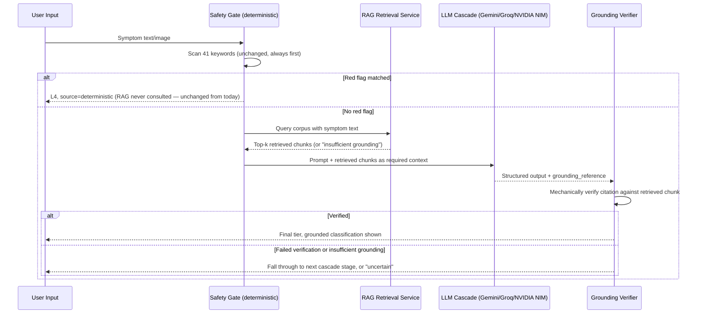

# Document 14 — Clinical RAG System: Design & Integration Plan

## 0. Scope correction, stated once here so the rest of this document can just be the plan

A RAG corpus for a system giving clinical guidance should be **small, authoritative, versioned, and licensing-safe** — not "the whole internet." This isn't a smaller ambition, it's the actual finding from the research behind this plan: ungoverned web sources are where hallucination gets *worse*, not better, and a governed source set has been shown to cut hallucination rates dramatically compared to unstructured retrieval. So §1 is a defined, reviewable source list, not a scraping target list — and it deliberately excludes anything paywalled or scraping-prohibited, both because that's a real legal exposure for your team and because low-provenance content is exactly what degrades a RAG system's reliability.

Also worth restating once: this corpus is for **retrieval**, not fine-tuning material. It gets embedded and indexed so the LLM cascade can look things up at query time — it does not get trained into any model's weights. `13_FINE_TUNING_TRAINING_PLAN.md` already covers the one place fine-tuning belongs (the on-device edge model), and that document's fine-tuning is about teaching the model to *use* retrieved context well, not to memorize this corpus.

**Second correction, added per `15_AI_STRATEGY_UNIFIED.md` §2 and §4: this corpus contains clinical guideline text only — never pricing or scheme-eligibility data.** PM-JAY scheme rules and curated hospital pricing already live in a deterministic lookup/rule engine (`02_PRD.md` FR-4, FR-5) that is structurally incapable of hallucinating. Pulling that data into this RAG corpus and having a model reason over it would replace a stronger guarantee (a lookup) with a weaker one (grounded generation) — see doc 15 §4 for the full reasoning. Everything below is scoped to clinical/triage content only.

---

## 1. The Source Corpus — curated, not scraped indiscriminately

| Source | Content | Access method | License/status |
|---|---|---|---|
| WHO IMCI (Integrated Management of Childhood Illness) guideline chartbooks | Pediatric severity/triage criteria | Official WHO publication download (PDF, publicly posted) | WHO open-access publication terms |
| WHO ETAT (Emergency Triage Assessment and Treatment) course materials | Emergency triage decision criteria — directly maps to your L1–L4 tiers | Official WHO publication download | WHO open-access publication terms |
| MoHFW Standard Treatment Guidelines / IPHS (Indian Public Health Standards) | India-specific facility-tier and treatment-pathway protocols — the most directly applicable source to your actual routing logic | Government of India open data portals / MoHFW official publications | Open Government Data License (India) |
| ICMR clinical guidelines (condition-specific, where published openly) | India-specific clinical management guidance | ICMR official publications | Public, government-published |
| NLEM 2022 (already in `07_DATA_CATALOG.md`) | Essential medicines list — useful for grounding any medication-adjacent language your system needs to handle carefully | NPPA official publication | Open Government Data |
| NCBI Bookshelf / StatPearls (selected condition entries relevant to your 10 tracked diseases) | General clinical reference for supplementary grounding, not primary authority for triage decisions | NCBI open access | US National Library of Medicine, public domain / open access |
| MedlinePlus (NLM) | Plain-language condition summaries — useful for the *explanatory* language your system shows to patients, not for the underlying urgency decision itself | NLM open access | Public domain (US government work) |
| PubMed abstracts (not full paywalled articles) via the official E-utilities API | Supplementary evidence citations for specific condition-severity claims, where needed | Official NCBI E-utilities API — a proper API, not scraping | Abstracts are openly accessible via the API by design |

**Explicitly excluded, and why:** general health blogs, forum content (Reddit/Quora-style symptom discussions), SEO-optimized health content sites, and any paywalled clinical reference (UpToDate, subscription journal full-text, proprietary textbooks). None of these meet the authority bar for a safety-critical system, and several carry real copyright/ToS risk if scraped at scale. If your team encounters a source that looks useful but sits behind a login or a restrictive robots.txt/terms of service, the answer is not to route around that — it's excluded, full stop.

**MVP scope, given your 4–6 week window:** don't try to ingest all of the above before demo. Start with WHO IMCI + WHO ETAT + MoHFW STGs for your existing 17 triage conditions and 10 tracked diseases specifically — that's a corpus size a team can actually curate, chunk, and validate well in the time available. Everything else in the table is a legitimate expansion target, explicitly scoped as post-MVP.

## 2. Ingestion Pipeline

1. **Acquisition:** download official PDFs/publications directly from the source organization's own site (WHO, MoHFW, ICMR, NPPA, NCBI) — via their official download links or, for PubMed, the official E-utilities API. No general-purpose crawling.
2. **Format conversion:** PDF → structured text, preserving section headers and hierarchy (not a flat text dump — the section structure is what makes the next step possible).
3. **Chunking strategy — clause/section-level, not fixed-size.** Current research on chunking is specific here: for legal and medical documents, the correct unit of retrieval is the clause or labeled section, not an arbitrary token window — a fixed-size chunk boundary can cut a contraindication or severity criterion in half and hand the retriever an incomplete warning. Chunk by the document's own structure (e.g., one chunk per named symptom/severity-criterion section in an IMCI chartbook), and attach a 5–10% overlap between adjacent chunks to preserve context at boundaries.
4. **Metadata per chunk:** source document name, publication/revision date, section path (e.g., "WHO ETAT §Airway and Breathing"), applicable population (pediatric/adult/all), and a stable chunk ID — this is what makes the grounding-verification step in §5 possible.
5. **Versioning:** every ingested document gets a `corpus_version` and an ingestion date; when a source guideline is revised, re-ingest as a new version rather than silently overwriting — this is the same discipline as your dataset-versioning approach elsewhere in this documentation suite.

## 3. Embedding & Indexing

- **Vector store: pgvector on your existing Neon Postgres.** This is the single most convenient infrastructure decision available to you — pgvector is available on every Neon plan, including free, with no add-on cost, and it's a `CREATE EXTENSION` statement, not new infrastructure. You already run Postgres; this adds vector search to it rather than standing up a separate vector database service.
- **Embedding model:** since your corpus and your users span English, Hindi, and Bengali (with 9 languages overall), a general English-only embedding model will underperform. Use a multilingual sentence-embedding model — a solid free/open baseline is a multilingual E5-family model; for higher retrieval quality on lexically diverse and code-mixed queries (which is exactly your real-world input pattern — see `12_AI_RELIABILITY_HARDENING_PLAN.md` §B.7 on code-switching), a late-interaction retriever (ColBERT-style) is currently reported as the strongest open option for multilingual/code-mixed corpora specifically, at the cost of more engineering complexity and compute than a standard dense embedding — evaluate both against your own retrieval-quality metrics (§7) before committing to the heavier option given your free-compute budget.
- **Indexing:** pgvector supports HNSW indexing for fast approximate nearest-neighbor search — appropriate once your corpus grows past a trivial size; for the MVP corpus scope in §1, an exact search may even be fast enough without an index, so don't over-engineer this before you have a reason to.

## 4. Retrieval Strategy

- **Hybrid retrieval, not dense-only.** Pure keyword/BM25 retrieval has been shown to fail significantly on lexically diverse clinical queries (as low as 35% top-10 recall in one comparable clinical RAG evaluation) — but pure dense retrieval alone can miss exact clinical-term or drug-name matches that a keyword search would catch. Combine both: dense embedding similarity for semantic matches, plus a keyword/exact-match layer specifically for clinical terms, drug names, and any structured codes your system uses — then merge and rerank.
- **Query construction:** the user's raw symptom text (in whichever of the 9 languages) is what gets embedded for retrieval — this only works if your embedding model actually handles that language well, which is why the multilingual model choice in §3 isn't a minor detail.
- **Top-k retrieval with a relevance threshold, and abstention below it.** Retrieve k=3–5 chunks (a reasonable starting point seen in comparable clinical RAG systems). If nothing clears a defined relevance threshold, the system must say so explicitly — "insufficient grounded information for this input" — rather than let the LLM cascade reason from ungrounded parametric memory. This abstention behavior is the RAG-specific instance of the same "fail toward caution" principle already established for your safety gate.

## 5. Grounded Generation & Verification

This reuses the double-lock grounding pattern from `12_AI_RELIABILITY_HARDENING_PLAN.md` §A.3, applied to clinical text instead of financial figures:

1. The prompt to each cascade stage (Gemini/Groq/NVIDIA NIM — see §6 for exactly where this sits in your pipeline) includes the retrieved chunks as required context, with an explicit instruction to reason only from that context, not general medical knowledge.
2. The model's structured output includes a `grounding_reference` field citing which retrieved chunk(s) support its classification.
3. **Mechanical verification, outside the model:** confirm the cited chunk ID was actually among the chunks retrieved for this query (not hallucinated), and that the model's stated reasoning has meaningful token overlap with that chunk's content (the same semantic-overlap check used for the financial "phantom metric" guard, applied here to catch a reasoning claim attributed to a guideline section it doesn't actually support).
4. If verification fails, treat the output the same as a cascade-stage failure (`03_SYSTEM_ARCHITECTURE.md` §5) — fall through to the next stage or to `uncertain`, never display an unverified clinical claim.

## 6. Where This Sits in Your Existing Architecture

**The critical point:** RAG is inserted entirely *after* the deterministic safety gate and only ever influences the refinement tier's reasoning — it never gets a vote on whether something is an emergency once the gate has already caught it. This is additive to your existing architecture, not a replacement of any part of it.

## 7. Step-by-Step Build Plan

| Step | What | Fits into roadmap as |
|---|---|---|
| 1 | Finalize the MVP source list (§1), confirm licensing/access for each, download official documents | New Phase 0 task — do this alongside `08_ROADMAP_EXECUTION_PLAN.md` Phase 0, since it has no code dependencies |
| 2 | Build the ingestion pipeline (PDF→structured text, clause-level chunking, metadata tagging) | Phase 1 addition |
| 3 | Enable pgvector on Neon, choose and test the embedding model on a small sample, index the MVP corpus | Phase 1 addition |
| 4 | Build the retrieval service (hybrid retrieval, reranking, relevance threshold/abstention) | Phase 2 addition — this is genuinely new backend work, budget real hours for it |
| 5 | Integrate retrieval into the existing cascade prompts (§6), add the `grounding_reference` field to the structured output schema | Phase 2 addition, alongside your existing AI-extension work |
| 6 | Build the mechanical grounding verifier (§5) | Phase 2 addition |
| 7 | Retrieval-quality evaluation (§8) against your held-out test set | Phase 3, alongside your existing calibration work from `12_AI_RELIABILITY_HARDENING_PLAN.md` |
| 8 | Corpus freshness process: a documented procedure for re-ingesting when a source guideline is revised, plus a periodic manual check that your sources haven't been updated since last ingestion | Post-MVP / ongoing, not a hackathon-week deliverable |

**Honest scope note, tying back to `08_ROADMAP_EXECUTION_PLAN.md` risk #6 (scope creep) and #15 (claims outpacing build):** this is a real, multi-week addition to an already full 6-week plan, not a small bolt-on. Before committing to it inside the hackathon window, decide explicitly with your team which existing Phase 2/3 item (`08_ROADMAP_EXECUTION_PLAN.md`) it displaces, rather than silently stacking it on top — the same discipline that document already recommends for any new scope. If the honest answer is that it doesn't fit before the demo, the credible move is to build and demo the retrieval + grounding pipeline against the small MVP corpus only, and present the full multi-source corpus expansion as an explicit next-phase roadmap item — which is a *stronger* SIH pitch point than an unfinished attempt at the full version, for the same reason `12_AI_RELIABILITY_HARDENING_PLAN.md` argued for cutting the cost-scrape fallback: a smaller thing that works and is honestly scoped beats a bigger thing you can't fully stand behind.

## 8. Evaluation

Add to `09_QA_TEST_PLAN.md`:

| Test category | What it checks |
|---|---|
| Retrieval recall@k | For a held-out set of symptom queries with known correct guideline sections, does retrieval actually surface the right chunk in the top k? |
| Groundedness rate | What fraction of generated classifications have a `grounding_reference` that survives mechanical verification (§5)? |
| Abstention correctness | For queries genuinely outside corpus coverage, does the system correctly report insufficient grounding rather than guessing? |
| Multilingual retrieval parity | Does recall@k hold up similarly across English/Hindi/Bengali queries for the same underlying clinical question, or does one language systematically retrieve worse? |
| Corpus staleness check | Automated or manual periodic check that no ingested source has a newer official revision available |

## Further Reading

- Lewis et al., *Retrieval-Augmented Generation for Knowledge-Intensive NLP Tasks* (2020) — the foundational RAG paper
- *Evaluating RAG Chunking Strategies in 2026* — source of the clause/section-level chunking recommendation for legal and medical domains in §2
- *Bridging Clinical Narratives and ACR Appropriateness Guidelines: A Multi-Agent RAG System for Medical Imaging Decisions* — source of the BM25 recall comparison in §4
- *FHIR-RAG-MEDS: Integrating HL7 FHIR with Retrieval-Augmented Large Language Models for Enhanced Medical Decision Support* — a comparable architecture combining structured patient data with guideline retrieval, relevant background for your own FHIR-shaped export work (`02_PRD.md` FR-14)
- Neon, *The pgvector extension* documentation — setup reference for §3
