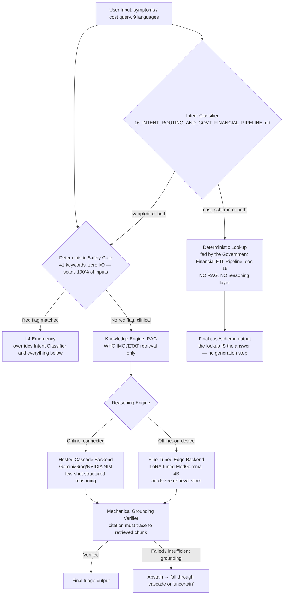

# Document 15 — Unified AI Strategy: The Fine-Tuned RAG Architecture

**This is now the canonical single-page reference for the project's AI strategy.** Every other document that touches AI behavior (`03_SYSTEM_ARCHITECTURE.md` §5, `06_AI_MODEL_SPEC.md`, `12_AI_RELIABILITY_HARDENING_PLAN.md`, `13_FINE_TUNING_TRAINING_PLAN.md`, `14_RAG_SYSTEM_DESIGN.md`) has been updated to point back to this document rather than restate it, so the architecture stays defined in exactly one place.

Your framing — separate the **Knowledge Engine** (facts, via RAG) from the **Reasoning Engine** (behavior and structure, via a fine-tuned model) — is the right pattern, and most of it is already what docs 12–14 built. This document keeps that pattern, and makes two corrections needed to keep it something your team can actually build for free by December: the Financial Spot needs a *different, stronger* pattern than RAG+reasoning, not the same one; and "the fine-tuned model" has to become two backends sharing one contract, because you can only actually fine-tune the part that runs on-device.

---

## 1. The Architecture, End to End

**Read the diagram carefully on two points:** the Intent Classifier never gets to skip the safety gate — every input hits the gate regardless of classified intent, and a matched red flag overrides the classifier's routing decision entirely. And the Financial Spot's path (`K2`) still does not go through the Reasoning Engine — it's now fed by a scheduled, mechanically-verified, human-reviewed ETL pipeline (`16_INTENT_ROUTING_AND_GOVT_FINANCIAL_PIPELINE.md` Task 2) instead of a one-time static curation, but the query-time answer mechanism is exactly as deterministic as before. Dynamic sourcing, static-guarantee answering.

## 2. The Knowledge Engine (RAG) — scope, precisely

Full design: `14_RAG_SYSTEM_DESIGN.md`. Scope, restated precisely because your original framing grouped three things together that need to be split:

| Data type | Goes through RAG? | Why |
|---|---|---|
| WHO IMCI/ETAT triage guidelines, MoHFW clinical protocols | **Yes** | Genuinely open-ended: a symptom presentation has to be *matched* against guideline criteria, which is exactly what retrieval + reasoning is for |
| PM-JAY / scheme eligibility rules | **No — deterministic rule engine, unchanged from `02_PRD.md` FR-5** | These aren't facts to retrieve and reason over, they're a rule evaluation with a fixed, enumerable rule set — a rule engine gives a stronger guarantee than RAG ever can (see §4) |
| Curated hospital/procedure pricing | **No — deterministic DB lookup, unchanged from `02_PRD.md` FR-4** | Same reason — this is a lookup, not an interpretation task |

The Knowledge Engine's corpus (`14_RAG_SYSTEM_DESIGN.md` §1) is clinical guideline text only. It is not a store of pricing or scheme data, and it never will be — that data already lives in a place that's structurally incapable of hallucinating, and moving it into a retrieve-then-reason pipeline would be a downgrade, not an upgrade.

## 3. The Reasoning Engine — one contract, two backends

Your description — "it doesn't memorize facts, it memorizes how to think" — is the right target, and it's exactly what `13_FINE_TUNING_TRAINING_PLAN.md` already scoped. The correction is about *where* that fine-tuned model can actually run:

| Backend | How it achieves "reasoning, not memorization" | Where it runs |
|---|---|---|
| **Hosted Cascade Backend** (Gemini 1.5 Flash → Groq Llama-3.2-90B-Vision → NVIDIA NIM Llama-3.1-70B) | **Cannot be fine-tuned on any free tier at this model scale.** Its equivalent of "fine-tuned reasoning" is achieved through structured few-shot prompting: the same instruction pairs you'd use as fine-tuning data (`13_FINE_TUNING_TRAINING_PLAN.md` §3) are instead injected as in-context exemplars in the system prompt, teaching the same reasoning structure and output format without touching model weights | Your servers (Render), online only |
| **Fine-Tuned Edge Backend** (LoRA-tuned MedGemma 4B, `13_FINE_TUNING_TRAINING_PLAN.md` §2) | **Genuinely fine-tuned** — this is the one place actual weight-level training happens, because it's a model you own and can train on free Colab/Kaggle GPU compute | The user's own device, via ONNX, online or offline |

Both backends are required to emit the **same structured output contract** (severity tier, confidence, `grounding_reference`) so the rest of the system — the mechanical verifier, the UI, the logging — doesn't need to know or care which backend produced a given result. That shared contract is what makes this legitimately "one Reasoning Engine," not two unrelated systems that happen to sit next to each other.

**One technical requirement this creates, not optional:** the edge backend can't reach your Neon-hosted RAG vector store when it's actually offline (which is the whole point of it existing). It needs its own **on-device retrieval store** — a compact, compressed subset of the Knowledge Engine's corpus, bundled into the app, searched locally. This is new scope beyond what `14_RAG_SYSTEM_DESIGN.md` originally specified (that document assumed a server-side pgvector store) and needs to be added to the Phase 4 edge-model roadmap item as its own task.

## 4. Why the Financial Spot is deliberately excluded from this pattern

This is the one place your instructions, applied literally, would have made the system *less* reliable, not more — worth being explicit about why:

RAG-then-reasoning is the right pattern for the Accessibility Spot because the input is genuinely open-ended (infinite ways to describe a symptom) and needs to be matched against reference criteria. The Financial Spot has no such ambiguity: given a disease ID and a funding route, there is exactly one correct number, already sitting in your curated database. **Retrieval, in that case, already *is* the complete answer — there is nothing left for a reasoning step to do except potentially introduce an error while restating it.** A rule engine and a database lookup are stronger guarantees than "RAG-grounded LLM output" precisely because they contain no generative step at all — not even a grounded one. Keeping the Financial Spot outside this architecture isn't a gap in applying the pattern; it's the pattern correctly recognizing where it doesn't apply.

**This doesn't mean the underlying data has to be static.** `16_INTENT_ROUTING_AND_GOVT_FINANCIAL_PIPELINE.md` specifies a scheduled, government-source-only ETL pipeline that keeps the curated database current — LLM-assisted extraction, mechanically verified against source text, human-confirmed before going live — without ever putting a model in the query-time answer path. The data gets dynamic; the guarantee stays absolute.

## 5. Synthesis — how a final answer actually gets produced

- **Clinical/triage path:** Knowledge Engine retrieves guideline chunks → Reasoning Engine (either backend) reasons over those chunks only, per its shared contract → Mechanical Grounding Verifier (`12_AI_RELIABILITY_HARDENING_PLAN.md` / `14_RAG_SYSTEM_DESIGN.md` §5) confirms the output's citation genuinely traces to a retrieved chunk → only then is it shown to the user. Any failure at the verification step falls through the existing cascade, ultimately to `uncertain` — never to an unverified guess.
- **Financial/scheme path:** deterministic lookup → the result. No reasoning step, no verification step needed, because there's nothing generative to verify.
- **Both paths sit downstream of the deterministic safety gate**, which is untouched by any of this and remains the actual final authority on emergencies.

## 6. What this architecture can honestly claim — stated once, precisely, so it doesn't need restating elsewhere

- **Deterministic safety gate, scheme matcher, curated cost lookup:** true zero hallucination, because no model is in the decision path. This is the strongest claim in the system, and it's unconditional.
- **Financial Spot overall:** true zero hallucination on the primary path, by the same logic as above (§4).
- **Clinical/triage Reasoning Engine (either backend), RAG-grounded and verified:** substantially and measurably reduced hallucination risk versus an ungrounded model — this is a real, large improvement, consistent with the research already cited in `12_AI_RELIABILITY_HARDENING_PLAN.md` and `14_RAG_SYSTEM_DESIGN.md` — but not a mathematical zero, because retrieval can still miss the right chunk and grounded reasoning can still misapply a correct citation. This is why the mechanical verifier and the abstention behavior exist: to make the failure mode "say nothing" rather than "confidently say something wrong."

Use "bulletproof, hallucination-free" as your pitch's *aspirational framing* if you want — it's a fair characterization of the deterministic majority of the system. Don't use it as a technical claim about the Reasoning Engine specifically if a judge or clinical mentor asks a direct follow-up question about it; §6 above is the answer to give instead, and it's a stronger answer than an overclaim would be.

## 7. Where each piece is specified in full

| Concern | Document |
|---|---|
| Overall system architecture, diagrams, deployment | `03_SYSTEM_ARCHITECTURE.md` |
| Model selection, prompt templates, evaluation metrics | `06_AI_MODEL_SPEC.md` |
| Hallucination risk mapping and mitigation techniques | `12_AI_RELIABILITY_HARDENING_PLAN.md` |
| Fine-tuning method, data, and the statistical validation requirement | `13_FINE_TUNING_TRAINING_PLAN.md` |
| RAG corpus, ingestion, retrieval, and grounding verification | `14_RAG_SYSTEM_DESIGN.md` |
