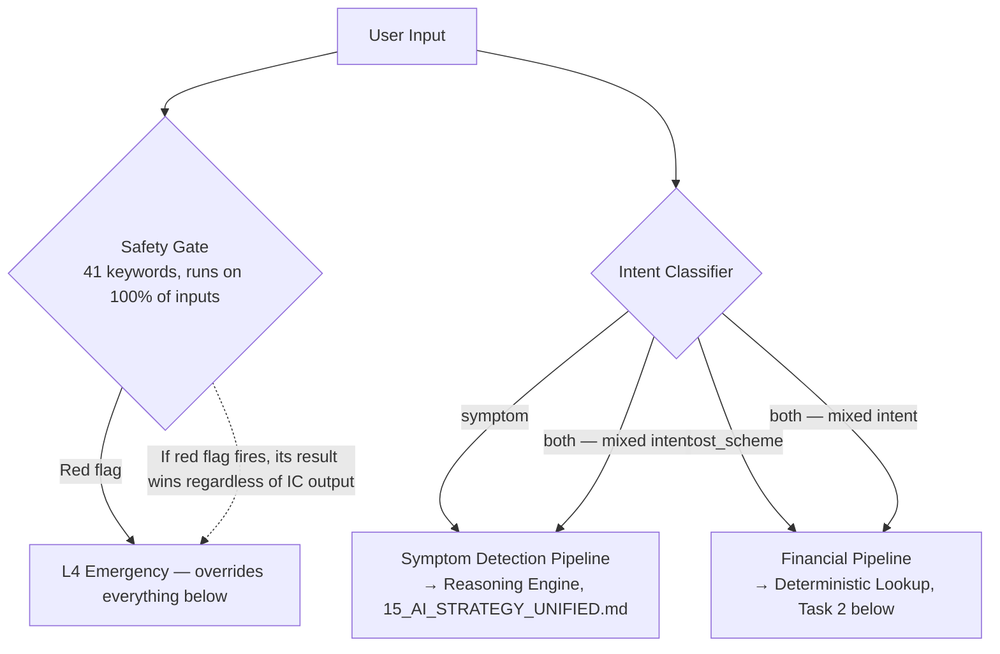
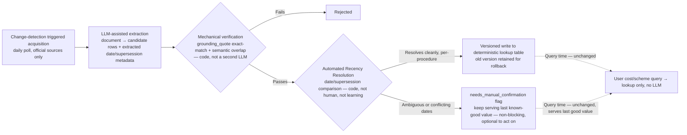

# Document 16 — Intent Routing & Government-Only Financial Data Pipeline

## Task 1: Intent Classifier — Top-Level Input Routing

### 1.1 The one rule that governs everything else in this section

**The deterministic safety gate scans every single input, unconditionally, regardless of what the Intent Classifier decides.** The classifier determines which *secondary* pipeline handles a request after the gate has already looked at it — it never gets the authority to skip the gate. A routing bug must never be able to become a safety bug. This is the same non-negotiable rule already governing the AI cascade (`04_AI_SAFETY_ETHICS.md`), extended to cover this new component.

### 1.2 Design

- **Primary classifier: deterministic, keyword/pattern-based**, matching against a small, maintained term list per language — cost-intent terms ("cost," "price," "kharcha," "kitna paisa," scheme names like "PM-JAY," "yojana") versus symptom-intent terms (the existing safety-gate vocabulary plus general symptom language). Zero-latency, zero-cost, zero-hallucination — consistent with every other "deterministic first" component in this system.
- **Fallback classifier: a single lightweight LLM call**, used only when the deterministic pass returns low confidence (ambiguous phrasing). This is a classification task, not a generative one — constrain its output to the same three labels, structured-output-enforced.
- **Mixed-intent handling is not an edge case to minimize, it's a required behavior.** "I have chest pain, how much will treatment cost" must hit both pipelines — collapsing this to a single intent risks silently dropping the symptom pipeline for a message that also happens to mention cost. When in doubt, the classifier should prefer routing to *both* over routing to neither or picking one.
- **Output contract:** `{intent: "symptom" | "cost_scheme" | "both", confidence: float, method: "deterministic" | "llm_fallback"}`.

## Task 2: The Government-Only Financial Data Pipeline

### 2.0 What changed from the literal request, and why

The request specified "RAG + Fine-Tuned LLM" for cost estimation, with an "LLM-assistive verification step." Both of those choices reintroduce the exact hallucination surface `15_AI_STRATEGY_UNIFIED.md` §4 already argued this spot shouldn't have — a generative step where a deterministic lookup already suffices, and a verification method (one model checking another) that doesn't actually catch the errors it's meant to catch, because the checking model can share the same blind spot as the checked one. What's built below keeps your actual goal — **government data that updates dynamically instead of sitting as a static one-time snapshot** — while keeping the user-facing answer 100%-lookup, 0%-generation.

### 2.1 Government-Only Source Allow-List

| Source | Data | Access |
|---|---|---|
| PM-JAY (pmjay.gov.in / hospitals.pmjay.gov.in) | HBP master list, hospital empanelment status | Official portal / published PDF |
| CGHS (cghs.nic.in) | CGHS rate lists for empaneled government/public facilities | Official portal / published PDF |
| State/UT health scheme portals — **expanded to all 28 states + 8 UTs**, see `21_state_scheme_registry.csv` | State-specific scheme coverage and eligibility rules | Official state/UT government portals only — registry currently has scheme names for 17/36, verified document URLs for 0/36; this is a rolling acquisition task, not a one-time list |

**West Bengal status change, flagged 2026-09-06:** West Bengal joined AB-PM-JAY in May 2026 (benefits live July 2026) — it was previously the only state running its health coverage entirely outside PM-JAY via its own WBHS/Swasthya Sathi schemes. The original 8-scheme list's WBHS entry needs re-verification against this change before the next ETL cycle: confirm whether WBHS (government employees) and Swasthya Sathi (all families) now coexist alongside PM-JAY coverage, or whether either has been superseded, before treating the existing WBHS entry as current.
| ESIC (esic.gov.in) | ESIC scheme coverage | Official portal |
| NHA Health Facility Registry (already in `07_DATA_CATALOG.md`) | Public facility identity/tier data | Official public search |

**Hard exclusion, enforced as an allow-list, not a denylist:** if a source isn't on this table, it isn't in scope — no private hospital price aggregators, no insurance comparison sites, no commercial billing data, regardless of how convenient or comprehensive they look. An allow-list is a stronger control than trying to remember to exclude bad sources one at a time.

### 2.2 The Pipeline — LLM-Assisted Extraction, Mechanically Verified, Automatically Resolved (no human review loop)

**Revised per team constraints: no admin/review interface exists or is planned, and no human-in-the-loop workflow is wanted.** The design below removes the human sign-off step entirely and replaces it with something more reliable for this specific job — deterministic date comparison — while keeping the same "never guess, abstain instead" discipline everywhere a human previously served as the safety net.

1. **Acquisition — change-detection triggered, not calendar-fixed** (superseded by `26_DYNAMIC_CHANGE_DETECTION_REFRESH.md`): a daily poll checks each source in the allow-list for an actual change (ETag/Last-Modified header or content hash) and triggers this pipeline immediately when one's detected, official sources only, allow-list enforced.
2. **LLM-assisted extraction** — now extracts three things per candidate row, not one: the cost/scheme figure itself, its `grounding_quote`, and any **date/supersession metadata** present in the source — publication date, "effective from"/"w.e.f." date, and any explicit supersession language ("supersedes Office Memorandum No. X dated Y," "in partial modification of..."). The supersession claim gets its own `grounding_quote` too — it must be independently verifiable in the source text, not just asserted, using the same mechanical check as the cost figure itself.
3. **Mechanical verification** — unchanged: code checks the cost figure's `grounding_quote` exists verbatim in the source, plus the semantic-metric overlap check against phantom-metric mismatches. If the row also claims a supersession, that claim's own quote is checked the same way.
4. **Automated Recency Resolution** — this replaces human sign-off, and it's the actual answer to "how do we know which of two real documents is current":
   - **Priority 1 — explicit, verified supersession.** If a mechanically-verified supersession claim exists, it deterministically overrides the specific procedure(s)/scheme(s) it names — nothing else in the older document is touched.
   - **Priority 2 — effective-date comparison, per procedure.** Where no supersession claim exists but both an existing and a new candidate row cover the *same* specific procedure/scheme entry, the row with the later effective/publication date wins for that entry only. A newer document does not invalidate entries it doesn't itself cover.
   - **Priority 3 — abstain, don't guess.** If dates are missing, unparseable, identical, or a supersession claim's scope is unclear, the row is **not** auto-published. It's flagged `needs_manual_confirmation` and the table keeps serving whatever value it last confirmed (or no value, if there was none) — never a silently-guessed one. This flag is a log entry someone can look at whenever convenient; the system does not wait on it, and nothing breaks if it's never looked at.
5. **Versioned write** — only rows that clear step 4's priority 1 or 2 get written; previous versions retained for rollback/audit, same as before.
6. **Query time — completely unchanged:** a patient's cost/scheme query still only ever hits a plain lookup against whatever the table currently holds. No LLM, no date logic, no review queue in that path — those all happen offline, triggered by detected source changes rather than a calendar date, before any patient ever asks a question.

**What the frontend actually needs, and it's small:** a "cost/scheme data as of [date]" label on the existing result display — the same treatment already specified for `facility_capacity_snapshot` in `02_PRD.md` FR-12. This is not a review interface; it's one line of UI telling the patient how fresh the number is, and it directly answers the concern about a document's currency being invisible to the end user.

### 2.3 Why this is a better fit for "mistakes aren't tolerated" than the literal request

The literal request's version has an LLM generating financial statements to a user, checked by another LLM. This version has an LLM assisting with tedious document parsing, checked by code, resolved by deterministic date/supersession logic — before it ever reaches a lookup table, and with no ongoing human workflow required to keep it running. Same dynamism, no query-time hallucination surface, no review queue to maintain.

### 2.4 Why retrieval alone, done live at query time, doesn't close the remaining gap

A natural next question: if retrieval mechanically verifies that a number really appears in a real government document, why not just do that retrieval live, per query, instead of on a schedule?

Because verifying a number came from *a* real government document isn't the same as verifying it came from the *current* one. Government rate schedules get revised — a live search for a specific procedure can return both last year's CGHS rate PDF and this year's revision, and both will pass a mechanical grounding check, because both genuinely contain the quoted figure. The double-lock check confirms provenance; it doesn't by itself resolve which of two genuinely valid documents is authoritative *right now* — that's what the Automated Recency Resolution step (§2.2 step 4) exists to do, using extracted dates and supersession language rather than a person's judgment. Doing that same resolution live, per query, under latency pressure and often with no network connectivity at all (this product is offline-first by requirement), is strictly worse than doing it offline on a schedule with no time pressure and the full document available to parse carefully. The fix for "I want this to cover more procedures and stay current" is expanding what's in the verified table faster and more broadly (§2.5), not moving the resolution step somewhere less reliable to get there sooner.

### 2.5 Coverage Expansion — RAG-Assisted Offline Extraction Across Full Government Package Lists

The 10-disease curated set was a hand-picked starting point, not a ceiling. To actually cover "other medical sectors" — which is the right goal — extend step 2 of the pipeline (§2.2) from "extract the procedures we thought to look for" to a systematic sweep:

1. **Ingest full government package lists, not single procedures.** PM-JAY's HBP master list alone covers roughly 1,900+ procedure packages; CGHS's rate schedule covers a comparably large set. Point the extraction step at the *entire* document, not a pre-selected procedure name.
2. **Use retrieval to help the extraction LLM navigate these large documents systematically** — chunk the full package list the same way `14_RAG_SYSTEM_DESIGN.md` §2 chunks clinical guidelines (by table row/section, not fixed token windows), and have the extraction step work through every chunk methodically rather than reactively searching for one query at a time. This is RAG's retrieval machinery genuinely earning its keep — organizing a large, systematic extraction job — without putting it in the live answer path.
3. **Every extracted row still goes through the full §2.2 pipeline**: double-lock grounding, semantic-metric overlap check, automated recency resolution, versioned write. Scale doesn't relax verification — it just means more rows pass through automated date/supersession comparison per triggered update cycle, which the deterministic resolution logic handles the same way at 10 rows or 1,900. Rows that don't resolve cleanly land in the non-blocking `needs_manual_confirmation` log rather than stalling the pipeline, so growing coverage doesn't create a growing backlog anyone has to clear.
4. **Result:** the deterministic table's coverage grows every ETL cycle, sourced from the same government-only allow-list, verified exactly as rigorously as the original 10 entries — genuinely broader and more current, with the query-time guarantee completely unchanged.

This is the version of "gets updated, and covers other medical sectors too" that doesn't cost you the thing you've been asking me to protect since the "mistakes aren't tolerated" framing started this whole line of work.

## Task 4: Documentation Update Plan

| File | What needs to change | Status |
|---|---|---|
| `03_SYSTEM_ARCHITECTURE.md` | Add Intent Classifier to the main diagram and module table (Task 1); add the ETL pipeline as a scheduled background process in the deployment section (Task 2) — it is not a user-facing API and shouldn't be modeled as one | **Executed below** |
| `15_AI_STRATEGY_UNIFIED.md` | Add Intent Classifier to the top of the end-to-end diagram; extend §4 to reference the ETL pipeline as the answer to "how does the Financial Spot stay current" | **Executed below** |
| `07_DATA_CATALOG.md` | Add CGHS as an explicit named source; annotate the existing government sources with the government-only allow-list framing and the quarterly refresh cadence | **Executed below** |
| `02_PRD.md` | FR-4 and FR-5 acceptance criteria get a note that underlying data now refreshes via the doc 16 pipeline rather than being a one-time curation | **Executed below** |
| `08_ROADMAP_EXECUTION_PLAN.md` | Add the Intent Classifier and the ETL pipeline as new, explicitly-scoped tasks — flag as additional scope needing an explicit tradeoff decision, same discipline as the RAG system's scope note | **Executed below** |
| `12_AI_RELIABILITY_HARDENING_PLAN.md` | Part A gets a short addition pointing to doc 16 as the concrete implementation of "if you want dynamic financial data, here's how without reintroducing risk" | **Executed below** |
| `14_RAG_SYSTEM_DESIGN.md` | No change needed — this pipeline is explicitly not a RAG pattern, and doc 14's existing exclusion of financial data from its corpus remains correct; it now has a named alternative (doc 16) to point to instead of an implicit "handled elsewhere" | **Confirmed, not touched** |
| `00_INDEX.md` | Add doc 16 (and doc 17, the research bibliography) to the index | **Executed below** |
