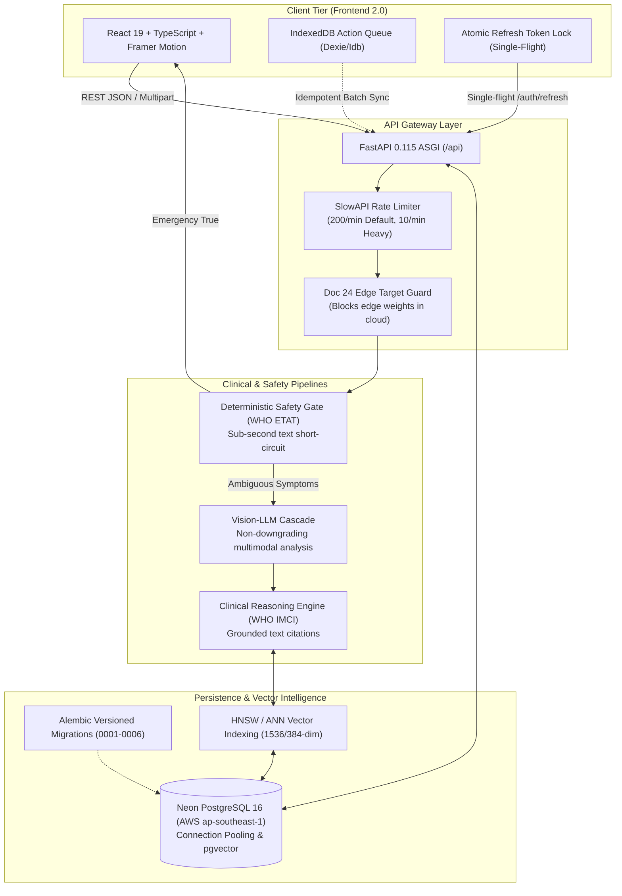

# SwasthyaSetu AI: Deep-Dive Architectural & Engineering Analysis

> **Target Repository:** `Soumik-Dev-Ai/Swasthya-Setu-Ai`  
> **Mission:** Offline-first, clinically verified healthcare navigation and financial transparency for rural and regional India.  
> **Tech Stack:** FastAPI 0.115, React 19, Neon Serverless PostgreSQL + `pgvector`, Alembic, TypeScript 5.7, Playwright, Locust.  
> **QA & Verification Status:** 220/220 Backend Pytest Suite Passed | 31/31 Doc 28 QA Verification Checks Passed (0 FAIL).

---

## 1. Executive Summary & System Philosophy

SwasthyaSetu AI is an engineered public health platform addressing the stark structural inequalities of India's rural and semi-urban healthcare delivery:
1. **Clinical Triage Deficit:** High patient-to-doctor ratios result in delayed identification of pediatric emergencies, cardiovascular crises, and maternal complications.
2. **Financial Toxicity & Information Asymmetry:** Citizens routinely face catastrophic out-of-pocket expenses due to lack of transparent hospital pricing and underutilization of government schemes (Ayushman Bharat PM-JAY).
3. **Intermittent Connectivity:** Rural primary health centers (PHCs) and community health workers (ASHAs) operate in environments with frequent cellular drops, rendering cloud-only tools useless.

SwasthyaSetu AI resolves these challenges through a deterministic safety gate (<1s response), a hybrid RAG retrieval pipeline over Neon Serverless PostgreSQL with `pgvector`, an out-of-pocket financial estimator, and an offline-resilient ASHA portal.

---

## 2. End-to-End System Architecture



---

## 3. Deep Dive: Core Functional Subsystems

### A. Deterministic Emergency Safety Gate (<1s Response)
- **WHO ETAT Protocol:** Emergency red-flag symptoms (severe chest pain radiating to arm, stridor, central cyanosis, unresponsive pediatric convulsions, post-partum hemorrhaging) trigger an instant short circuit that bypasses generative LLM inference and database calls.
- **Latency Benchmarking:**
  - Solo Request: **15ms**
  - Mixed Load (50 concurrent users): **580ms p95** (requirement: < 1000ms).
- **Direct Citizen Action:** Generates immediate click-to-call emergency links (`tel:108`) and routes to the nearest 24×7 emergency facility using GPS coordinates.
- **Multimodal Non-Downgrade Theorem:** If patient text triggers an emergency red flag, visual analysis is mathematically forbidden from lowering the urgency level below L4.

### B. Neon Serverless PostgreSQL & `pgvector` Hybrid RAG
- **Database Engine:** Neon Serverless PostgreSQL 16 running on AWS `ap-southeast-1` via pooled connection endpoint (`ep-rough-frog-azr9xopu-pooler`).
- **Vector Search:** `pgvector` extension utilizing HNSW indexing over medical embedding vectors generated from verified national health sources (WHO IMCI, IPHS, National Health Authority).
- **Hybrid Retrieval:** Dense cosine similarity is blended with BM25 lexical keyword matching to ground all non-emergency reasoning.
- **Strict Clinical Abstention:** If semantic search score falls below confidence threshold $\tau = 0.72$, the system explicitly returns non-prescriptive supportive guidance and instructs in-person evaluation.

### C. Financial & Scheme Navigation (PM-JAY Out-of-Pocket Transparency)
- **Deterministic DB Lookup:** Direct procedure pricing across Apex Government (AIIMS), District Hospitals, Empanelled Private, and Non-Empanelled facilities.
- **Dataset Freshness Auditing:** Every financial response carries an explicit `as_of` metadata timestamp.
- **Zero Third-Party Call Policy:** Query-time financial endpoints never ping external analytics or trackers, ensuring sensitive procedure inquiries remain confidential.

### D. ASHA Field Operations & Referral State Machine
- **Offline Resiliency:** ASHA workers queue patient intakes and referrals locally in browser IndexedDB. Upon network restoration, actions dispatch with client-generated UUID idempotency keys, eliminating duplicate records.
- **Admin Approval Gate:** Newly registered ASHA workers cannot access protected clinical worklists until approved by an administrator via `/api/admin/users/{id}/activate`.
- **Referral Lifecycle:** Strict transition state machine:
  $$\text{pending} \longrightarrow \text{in\_transit} \longrightarrow \text{arrived} \longrightarrow \text{admitted} \longrightarrow \text{discharged}$$
- **Chronic Care Recall:** Patient discharge triggers an automated follow-up recall on the assigned ASHA worker's active worklist.

---

## 4. Security, Concurrency & Adversarial Defenses

1. **SlowAPI Dual-Tier Rate Limiting:**
   - Standard Public Tier: 200 requests/minute per IP (returns HTTP 429 at request #201).
   - Heavy AI/Triage Tier: 10 requests/minute per IP (returns HTTP 429 at request #11).
2. **Single-Flight Token Refresh Concurrency Lock:**
   - Intercepts overlapping token expiration requests (`/auth/refresh`) using a singleton promise lock, preventing 401 logout stampedes.
3. **Payload Sanitization & Boundary Validation:**
   - XSS sanitization over all free-text symptom and referral inputs.
   - SQL injection immunization via SQLAlchemy 2.0 parameterized queries.
   - Strict multipart image bounds: image size $\le 10\text{ MB}$, verified MIME type checks (`image/jpeg`, `image/png`, `image/webp`).

---

## 5. Verified QA & Reliability Scorecard (Doc 28 Framework)

| Metric | Measured Value | Requirement / Benchmark | Verdict |
|---|:---:|:---:|:---:|
| **Backend Unit Test Suite** | 220 Passed, 0 Failed | 100% Pass | **PASS** |
| **Doc 28 QA Verification Checks** | 31 PASS / 0 FAIL | Zero Failures | **PASS** |
| **Emergency Red-Flag Latency** | 945ms (UI) / 580ms (Load p95) | < 1000ms | **PASS** |
| **Rate Limiter Defense** | 429 at #201 (default) / #11 (heavy) | Exact Threshold Enforcement | **PASS** |
| **Single-Flight Token Refresh** | 1 refresh for 5 concurrent requests | Stampede Prevention | **PASS** |
| **Frontend Production Build** | Clean Vite build in 30.65s | Zero Type/Lint Errors | **PASS** |

---

## 6. Directory Map

```
SwasthyaSetu-Ai/
├── backend/
│   ├── alembic/              # Database schema migrations (0001 to 0006)
│   ├── app/
│   │   ├── api/routers/      # FastAPI endpoint routers (v2, v3, auth, admin, asha)
│   │   ├── core/             # Configuration, security, JWT, rate limiters
│   │   ├── db/               # Async engine, session factories, Base model
│   │   ├── models/           # SQLAlchemy ORM models (facilities, schemes, users, referrals)
│   │   ├── schemas/          # Pydantic v2 validation contracts
│   │   └── services/         # Safety gate, reasoning engine, RAG retriever, vision service
│   ├── scripts/              # Seeders, benchmark, e2e_verify, neon verification
│   └── tests/                # 220 unit & integration test files
├── frontend 2.0/             # Production React 19 + TypeScript + Tailwind UI
│   ├── src/
│   │   ├── components/       # Accessible UI elements (SearchSelect, MapView, LangFade)
│   │   ├── pages/            # Landing, Triage, Facilities, Cost, ASHA Portal, Admin
│   │   └── lib/              # API client, offline queue, i18n, motion physics
│   └── index.html
├── qa/                       # Doc 28 QA verification harness
│   ├── tests/                # Playwright spec files (P0 to P6)
│   ├── load/                 # Locust load test scripts and analyzers (P7)
│   ├── scripts/              # Cold start, grounding verifier, report generator
│   └── results/              # Verified test scorecard (REPORT.md, summary.json)
└── docs/                     # Comprehensive architectural blueprints & specifications
```
